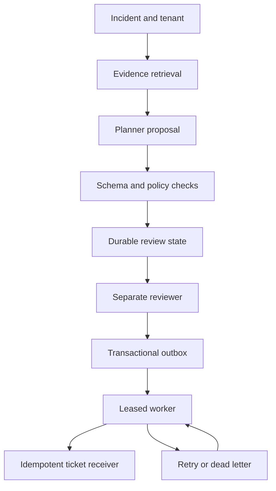

# Approval Ledger

A reference workflow for an uncomfortable failure case: **the tool completed an action,
but the worker died before recording success**.

An agent proposes a support follow-up using retrieved runbooks. A separate reviewer approves
the exact proposal. Delivery happens through a durable outbox to an idempotent ticket receiver.
The model has no approval authority and cannot invoke arbitrary tools.

## Try the failure, not just the happy path

Python 3.9+ and SQLite FTS5 are enough for the core experiment. No API key or paid model is required.

```bash
python -m unittest discover -s tests -v
python -m approval_ledger demo --out local/demo
```

Open `local/demo/report.html`. The report shows the event sequence and the ticket count before
and after recovery. The demo uses a controlled clock to expire a lease; the test suite also
starts a separate worker process and terminates it with `os._exit(77)` after receiver commit.

Observed locally on 17 November 2026: 27 core tests passed; the optional LangGraph test is
skipped until its dependencies are installed. The crash/retry scenario produced one ticket
and ended in `completed`. This is local transaction evidence, not production performance.

## Components



| Boundary | Decision |
|---|---|
| Retrieval | SQLite FTS5 with tenant filtering; lexical retrieval, not embeddings |
| Planner | Strict JSON proposal; deterministic fixture by default; optional OpenAI-compatible HTTP client |
| Approval | Different identity, scope check, tenant check, payload hash and expiry |
| Persistence | SQLite WAL; approval, state transition and outbox insertion share one transaction |
| Delivery | Leases with fencing tokens, capped exponential retry and dead-letter state |
| Receiver | Separate database with durable unique idempotency key and payload-hash check |
| Audit | Hash-linked events with bounded error categories; no bearer-token logging |
| Agent integration | Optional LangGraph interrupt/checkpoint adapter and read-only stdio MCP tools |

## A normal local workflow

```bash
python -m approval_ledger propose --key incident-001 --incident 'checkout latency'
# Copy the returned id and plan_hash after inspecting the proposal.
python -m approval_ledger review --run-id RUN_ID --plan-hash PLAN_HASH --decision approve
python -m approval_ledger deliver
python -m approval_ledger inspect --run-id RUN_ID
```

The CLI uses fixed demo identities to exercise the authorization rules. It does **not**
authenticate different people on a shared machine. Do not expose it as a public service.

An actual model endpoint can replace the fixture planner:

```bash
export LEDGER_MODEL_KEY='your-key'
python -m approval_ledger propose --key model-incident-001 --incident 'checkout latency' \
  --base-url https://YOUR_PROVIDER/v1 --model YOUR_MODEL
```

This sends the incident and retrieved evidence to the selected provider and may incur its
normal charges. Only the bundled fictional runbooks are included. Do not send employer data.
The project reads no provider key unless you configure one. Live-model quality is unmeasured.

## Optional framework adapters

Use Python 3.11+ for the extras:

```bash
python3.11 -m venv .venv
source .venv/bin/activate
python -m pip install -e '.[agents]'
python -m unittest discover -s tests -v
python -m pip freeze > local/environment-lock.txt
LEDGER_DB=local/session/ledger.db python -m approval_ledger.mcp_server
```

`build_graph()` accepts a durable LangGraph checkpointer. The optional test uses SQLite to
pause, close the graph, approve through the ledger and resume a reopened graph. Resume data
cannot grant approval; only an already committed review can do so. The outbox worker stays
outside the graph so checkpoint replay does not repeat a non-idempotent side effect.

The MCP adapter provides only `search_evidence` and `get_run`. It uses a bound local identity
over stdio and does not implement remote MCP OAuth. The introspection authorizer is a tested
claim-validation boundary with an injected external validator, not an identity provider or
completed OAuth deployment. Live OAuth, MCP and LangGraph execution remain unverified here.

## Guarantees and limits

- Delivery attempts are **at least once**. A single durable ticket effect depends on the
  receiver honoring the idempotency key. There is no generic distributed exactly-once claim.
- A lease can expire while a worker is slow. Fencing prevents stale acknowledgements;
  receiver idempotency prevents a duplicate effect. A real remote sink must supply that contract.
- Hash-linked audit records detect some edits. An attacker controlling the database can
  rewrite the chain or truncate it; external anchoring/WORM storage is needed for stronger assurance.
- Retrieval validates citation identity and tenant scope, not semantic truth. A reviewer must
  assess the proposed action. Citation presence is not a grounding score.
- Retries handle transient transport errors. Permanent/unknown errors leave recovery to the
  lease/budget mechanism; no silent fallback executes a different action.
- SQLite is a deliberate single-host choice for reproducible failure tests. This is not a
  demonstrated Kafka/PostgreSQL deployment, multi-node system, or production adoption story.

## Review the engineering

Start with [failure semantics](docs/DECISIONS.md), [test evidence](docs/VALIDATION.md), and
[what to validate next](docs/NEXT_EXPERIMENTS.md). The useful review questions concern transaction
boundaries, stale workers, identity propagation and replay—not the number of agent roles.

The evidence is the inspectable behavior, tests, decisions and stated limitations. Reviewers
can reproduce the failure case locally and inspect the exact state transitions.
